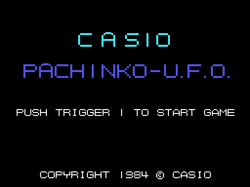

# The game

*Pachinko U.F.O.* is a pachinko machine, seen from the front: the balls go up the left side,
fall through the pins and either drop into a pocket, which pays balls, or are lost down the
hole at the bottom. In the centre there is a UFO. On the right, the record (HIGH-SCORE), the
score, the objective (CLEAR), the balls left and the LEVEL. The three machines are in
[The machines](THE-MACHINES.html).

Every GIF on this site is the ROM **running in openMSX** (a Japanese MSX1, at 60 frames per
second): on every frame the VRAM and the VDP registers are logged, and `tools/vdp.py` paints
them.

## The controls

| | joystick | keyboard |
|---|---|---|
| button 1 | button A of joystick 1 or 2 | the space bar |
| button 2 | button B of joystick 1 or 2 | GRAPH |

**Button 1 held down** charges the strength of the shot, from 0 to 15, one point per frame;
when it is let go, a ball leaves the launcher with that strength, upwards and to the side
(`lanzador`, 0x8B19). There can be up to eight balls on the machine at once (one in machine 2).
**Button 2** stops the slot machine of machine 1. Nothing else is used: there is no joystick
direction.

## The balls

The game starts with **50 balls**. Each ball shot costs one ball and one point
(`bola_menos`, 0x858D). A ball that drops into a pocket pays **10 balls and 10 points**
(`agujero_mete_bola`, 0x90FE); one that reaches the hole at the bottom is lost. With no balls
left, GAME OVER.

Each ball rolls under a gravity of one or two steps per frame and bounces off the pins, which
the game reads from a bitmap in RAM (`clavos`, 0x914A): six lines of pins around the ball say
where it is pushed. At the bottom, the machine curves down to the hole, and the ball slides
towards the centre (`bola_fondo`, 0x8E65).

## The objective and the levels

The game goes through the **three machines in turn** (`partida_ronda`, 0x8243). In machines 0
and 1, when the balls go past the objective (CLEAR) and no prize is running, PATTERN CLEAR and
the next machine; in machine 2 there is no objective: the big UFO has to be hit, and then LEVEL
CLEAR. After the three, LEVEL goes up by one and the machines start again: in the second lap the UFOs
take and give more, in the third there are more pins; after three laps the objective rises: **400, 600,
800 and 1000 balls** (0x817D), and then back to 400.

The record starts at 10000. If it reaches 100,000, **YOU WIN THE GAME!**: it stays at 99,999
and the game ends (`juego`, 0x86F2).

## The demonstration

Without touching anything on the title, the computer plays a machine chosen at random,
shooting with random strength, until button 1 is pressed or nine times 256 frames go by (about
40 seconds).
