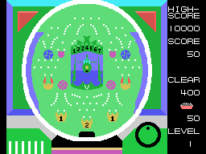
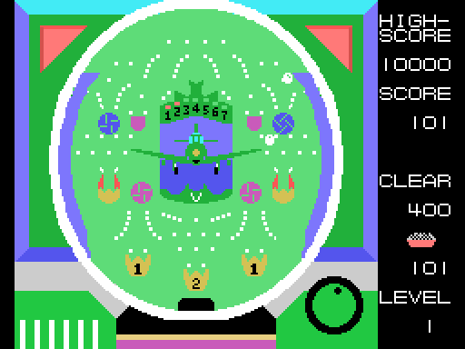
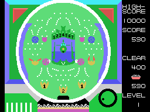
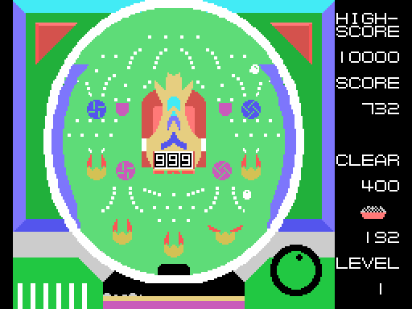
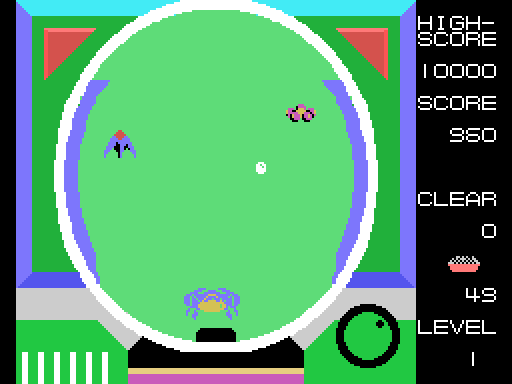
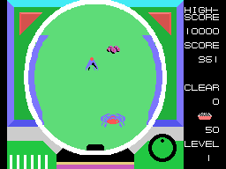

# The machines

## The shot

The launcher is at the bottom left; the longer button 1 is held, the higher the ball goes. The
balls are white sprites. Below the machine, in the middle, the tray fills up with balls: one tile
every 16 balls and one more layer every 256, counted in binary (`bandeja_pinta`, 0x87D5).

## Machine 0: the centre that opens

The centre is a green UFO with seven lamps, 1 to 7, and a **V** inside. At the bottom there are
three pockets marked **1, 2 and 1**: a ball in one of them gives that many **openings** of the
centre (`agujero_apertura`, 0x9056). While there are openings, the UFO spreads its wings and
folds them again every 48 frames (`centro`, 0x8A32); each time it closes, one opening less.
Open, it catches balls (`agujero_centro`, 0x90AF), and a ball in the V lights the next lamp and
gives **18 openings** more, up to seven times (`agujero_v`, 0x90E0).

Four pinwheels spin when a ball touches them (`molinillo_1`, 0x902A), and the tulips open and
close (`tulipanes`, 0x9295).

## Machine 1: the slot machine

The centre is an orange UFO with three figures in a window. A ball in its pocket gives a **spin**
(`agujero_tiradas`, 0x9085): the three figures roll and stop one after the other, and **button 2
stops them** sooner (`tragaperras`, 0x895E). Then it counts how many figures are 6 or more: one
gives 1 opening, two give 6, and three, the **jackpot**, 128 openings with its own sound
(`tragaperras_premio`, 0x89E4). In this machine the prize ends after 30 closings whatever is
left.

## Machine 2: the UFOs

The field is empty: no pins in the middle and no pockets, and only one ball at a time. Small and
medium UFOs fly from side to side (`ovnis`, 0x884E), between two and five depending on the
objective, and at the bottom the **big UFO** goes left and right, bobbing up and down. A ball
that hits one of the good UFOs gives points; one that hits the bad one takes balls away (10, 30
or 50 depending on the lap); the UFO hit bursts (`bola_ovni`, 0x8EAE). In the higher objectives
two good UFOs have to be hit before the big one comes out. A ball on the big UFO gives the
points sixteen times over and ends the machine: LEVEL CLEAR.

