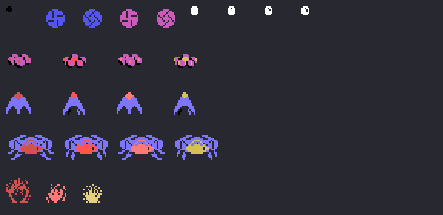

# The sprites

Everything on this page is **put together from the ROM tables** with `tools/hojas.py`. None of these images is a
screenshot.

**Checked against openMSX** on the recordings of this site: the sprite drawing table (VRAM 0x3800-0x3BBF) is
**identical** to the 960 bytes at 0x992F on the 43,152 frames where it is loaded, and the game's whole copy of the
sprite table (0xEBD0) matches, sprite by sprite, what is built here from the same frame's RAM on **15,263 frames** (721
of them on machine 2, with the U.F.O.s). Left out are the transition frames -18 with the copy not yet built, 37 with
the RAM already cleared and the copy still old, 1 with the previous frame's- and **1 unexplained**.

## The drawings

Thirty of 16 x 16 (0x992F), as they are at 0x3800 (`sprites_dibujos`, 0x8C07). Since the sprites are 16 x 16, the VDP
ignores the bottom two bits of the drawing number: the ball, which counts in twos (8, 10... 22), changes drawing every
two steps, and the windmill, which counts from 0 to 7 (`molinillos`, 0x8815), alternates two drawings.

## What is on the screen

`sprites` (0x8C14) builds the table on every frame: the **launcher** (drawing 0x24, black, at the place for the
strength from 0x8193), the four **windmills** of machine 1 (blue at the top and magenta at the bottom, as 0x8389 sets
them) or the **U.F.O.s** of machine 2, and the **balls** (white, eight at most).

Each U.F.O. is three sprites on top of each other (`sprites_ovni`, 0x8C52): the drawing + 4 in black, the drawing, and
the drawing + 8 in the colour of its step (the step + 7, with 0 becoming 6: dark red, red, light red and dark yellow).
The **small** one (0x4C or 0x58 depending on the step, in magenta), the **medium** one (0x34 or 0x40, in light blue),
the **big** one (two sprites side by side, 0x70 or 0x64, and 0x6C in the middle) and **blowing up** (0x28, 0x2C and
0x30). On the sheet: the launcher, the windmill, the ball and the three U.F.O.s in their four steps, and the explosion.

The three U.F.O.s, frame by frame (`ovnis`, 0x884E): the step every 8 frames, and every 4 for the big one, which also
goes up and down with the 32 heights at 0x8927.

