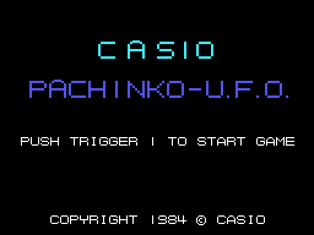

# La partida

*Pachinko U.F.O.* es una máquina de pachinko, vista de frente: las bolas suben por la
izquierda, caen entre los clavos y o bien entran en un agujero, que paga bolas, o se pierden por
el agujero de abajo. En el centro hay un OVNI. A la derecha, el récord (HIGH-SCORE), los puntos,
el objetivo (CLEAR), las bolas que quedan y el nivel (LEVEL). Las tres máquinas están en
[Las máquinas](LAS-MAQUINAS.html).

Todos los GIF de esta web son la ROM **funcionando en openMSX** (un MSX1 japonés, a 60 cuadros
por segundo): en cada cuadro se apuntan la VRAM y los registros del VDP, y `tools/vdp.py` los
pinta.

## Los mandos

| | mando | teclado |
|---|---|---|
| botón 1 | el botón A del mando 1 o del 2 | la barra espaciadora |
| botón 2 | el botón B del mando 1 o del 2 | GRAPH |

**El botón 1 sostenido** carga la fuerza del tiro, de 0 a 15, un punto por cuadro; al soltarlo,
sale una bola del lanzador con esa fuerza, hacia arriba y hacia el lado (`lanzador`, 0x8B19).
Puede haber hasta ocho bolas a la vez en la máquina (una en la máquina 2). **El botón 2** para el
tragaperras de la máquina 1. No se usa nada más: ni una dirección de la palanca.

## Las bolas

La partida empieza con **50 bolas**. Cada bola que se tira cuesta una bola y un punto
(`bola_menos`, 0x858D). Una bola que entra en un agujero paga **10 bolas y 10 puntos**
(`agujero_mete_bola`, 0x90FE); la que llega al agujero de abajo se pierde. Sin bolas, GAME OVER.

Cada bola rueda con una gravedad de uno o dos pasos por cuadro y rebota en los clavos, que el
juego lee de un mapa de bits en la RAM (`clavos`, 0x914A): seis líneas de clavos alrededor de la
bola dicen hacia dónde la empujan. Abajo, la máquina se curva hasta el agujero, y la bola resbala
hacia el centro (`bola_fondo`, 0x8E65).

## El objetivo y los niveles

La partida pasa por **las tres máquinas una tras otra** (`partida_ronda`, 0x8243). En las máquinas
0 y 1, cuando las bolas pasan del objetivo (CLEAR) y no hay premio en marcha, PATTERN CLEAR y la
máquina siguiente; en la máquina 2 no hay objetivo: hay que darle al OVNI grande, y entonces LEVEL
CLEAR. Después de las tres, LEVEL sube uno y las máquinas vuelven a empezar: en la segunda vuelta
los OVNIs quitan y dan más, en la tercera hay más clavos; tras tres vueltas sube el objetivo:
**400, 600, 800 y 1000 bolas** (0x817D), y luego otra vez 400.

El récord empieza en 10000. Si llega a 100.000, **YOU WIN THE GAME!** («has ganado»): se queda en
99.999 y la partida se acaba (`juego`, 0x86F2).

## La demostración

Si no se toca nada en el título, el ordenador juega una máquina elegida al azar, tirando con
fuerza al azar, hasta que se pulsa el botón 1 o pasan nueve veces 256 cuadros (unos 40 segundos).
