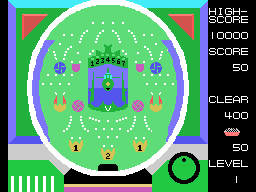
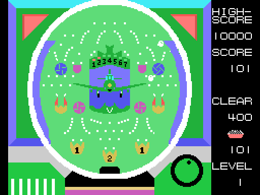
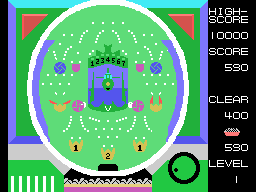
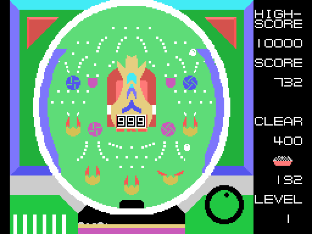
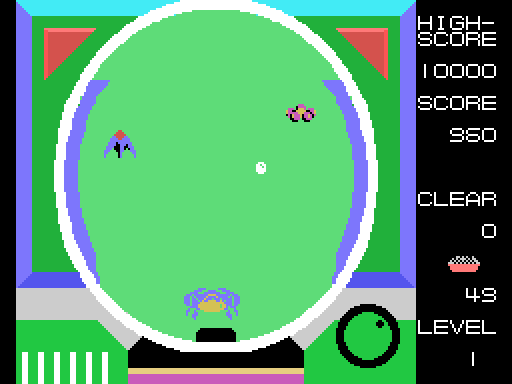
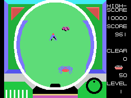

# Las máquinas

## El tiro

El lanzador está abajo a la izquierda; cuanto más se sostiene el botón 1, más alto sube la bola.
Las bolas son sprites blancos. Debajo de la máquina, en el centro, la bandeja se llena de bolas:
una casilla cada 16 bolas y una capa más cada 256, contadas en binario (`bandeja_pinta`, 0x87D5).

## La máquina 0: el centro que se abre

El centro es un OVNI verde con siete lámparas, del 1 al 7, y una **V** dentro. Abajo hay tres
agujeros marcados **1, 2 y 1**: una bola en uno de ellos da ese número de **aperturas** del centro
(`agujero_apertura`, 0x9056). Mientras hay aperturas, el OVNI abre las alas y las vuelve a cerrar
cada 48 cuadros (`centro`, 0x8A32); cada vez que se cierra, una apertura menos. Abierto, recoge
bolas (`agujero_centro`, 0x90AF), y una bola en la V enciende la lámpara siguiente y da **18
aperturas** más, hasta siete veces (`agujero_v`, 0x90E0).

Cuatro molinillos giran cuando los toca una bola (`molinillo_1`, 0x902A), y los tulipanes se abren
y se cierran (`tulipanes`, 0x9295).

## La máquina 1: el tragaperras

El centro es un OVNI naranja con tres cifras en una ventana. Una bola en su agujero da una
**tirada** (`agujero_tiradas`, 0x9085): las tres cifras giran y se paran una tras otra, y **el
botón 2 las para** antes (`tragaperras`, 0x895E). Luego cuenta cuántas cifras son 6 o más: una da
1 apertura, dos dan 6, y tres, el **premio gordo**, 128 aperturas con su propio sonido
(`tragaperras_premio`, 0x89E4). En esta máquina el premio se acaba a los 30 cierres, quede lo que
quede.

## La máquina 2: los OVNIs

El campo está vacío: sin clavos en medio y sin agujeros, y con una sola bola cada vez. OVNIs
pequeños y medianos vuelan de lado a lado (`ovnis`, 0x884E), de dos a cinco según el objetivo, y
abajo el **OVNI grande** va a izquierda y derecha, subiendo y bajando. Una bola que toca uno de los
OVNIs buenos da puntos; la que toca el malo quita bolas (10, 30 o 50 según la vuelta); el OVNI
tocado estalla (`bola_ovni`, 0x8EAE). En los objetivos altos hay que tocar antes dos OVNIs buenos
para que salga el grande. Una bola en el OVNI grande da dieciséis veces los puntos y acaba la
máquina: LEVEL CLEAR.

