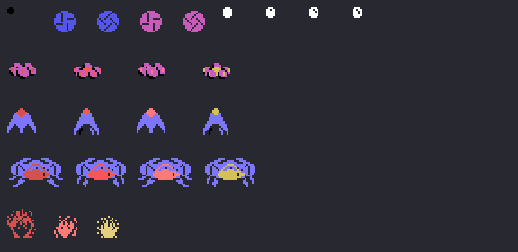
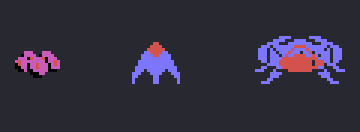

# Los sprites

Todo lo de esta p&aacute;gina est&aacute; **montado desde las tablas de la ROM** con `tools/hojas.py`. Ninguna imagen
es una captura.

**Cotejado con openMSX** en las grabaciones de la web: la tabla de dibujos de los sprites (VRAM 0x3800-0x3BBF) es
**id&eacute;ntica** a los 960 bytes de 0x992F en los 43.152 cuadros en que est&aacute; cargada, y la copia entera de la
tabla de sprites del juego (0xEBD0) casa sprite a sprite con lo que se monta aqu&iacute; con la RAM del mismo cuadro
en **15.263 cuadros** (721 de la m&aacute;quina 2, con los OVNIs). Fuera quedan los de las transiciones -18 con la copia
a&uacute;n sin montar, 37 con la RAM ya borrada y la copia todav&iacute;a vieja, 1 con la del cuadro anterior- y **1
sin explicar**.

## Los dibujos

Treinta de 16 x 16 (0x992F), tal cual en 0x3800 (`sprites_dibujos`, 0x8C07). Como los sprites son de 16 x 16, el VDP
no mira los dos bits de abajo del n&uacute;mero de dibujo: la bola, que cuenta de dos en dos (8, 10... 22), cambia de
dibujo cada dos pasos, y el molinillo, que cuenta de 0 a 7 (`molinillos`, 0x8815), alterna dos dibujos.

## Lo que hay en la pantalla

`sprites` (0x8C14) monta la tabla en cada cuadro: el **lanzador** (el dibujo 0x24, negro, en el sitio de la fuerza de
0x8193), los cuatro **molinillos** de la m&aacute;quina 1 (azules los de arriba y magenta los de abajo, como los pone
0x8389) o los **OVNIs** de la m&aacute;quina 2, y las **bolas** (blancas, ocho como mucho).

Cada OVNI son tres sprites encima uno de otro (`sprites_ovni`, 0x8C52): el dibujo + 4 en negro, el dibujo y el dibujo +
8 en el color de su paso (el paso + 7, y el 0 es el 6: rojo oscuro, rojo, rojo claro y amarillo oscuro). El
**peque&ntilde;o** (0x4C o 0x58 seg&uacute;n el paso, en magenta), el **mediano** (0x34 o 0x40, en azul claro), el
**grande** (dos sprites lado a lado, 0x70 o 0x64, y el 0x6C en medio) y **estallando** (0x28, 0x2C y 0x30). En la hoja:
el lanzador, el molinillo, la bola y los tres OVNIs en sus cuatro pasos, y la explosi&oacute;n.

Los tres OVNIs, cuadro a cuadro (`ovnis`, 0x884E): el paso cada 8 cuadros, y el grande cada 4, que adem&aacute;s sube
y baja con las 32 alturas de 0x8927.

